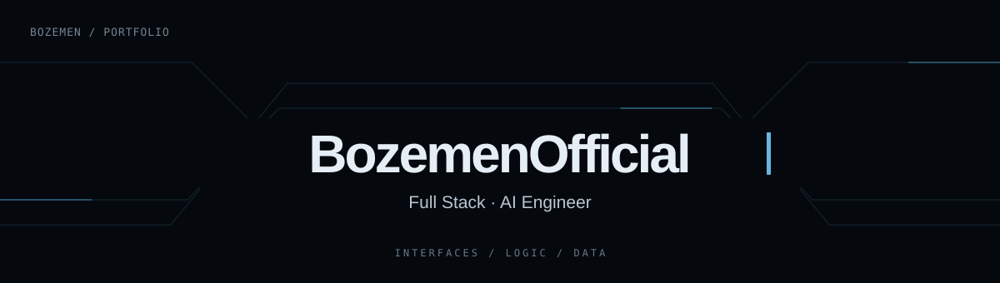

  

  

 

## ✨ My projects

### 🖥️ [Portfolio — personal website](https://github.com/BozemenOfficial/portfolio)

A website introducing me, my skills and my work. The repository includes Russian, Ukrainian and English interfaces, responsive layouts and animations.

**Demonstrates:** React, TypeScript, CSS, content organization and a multilingual interface.

[Open the repository →](https://github.com/BozemenOfficial/portfolio)

## 🌱 Current focus

## 💬 Get in touch

[Telegram — @Life_Boze](https://t.me/Life_Boze) · [My public repositories](https://github.com/BozemenOfficial?tab=repositories)
