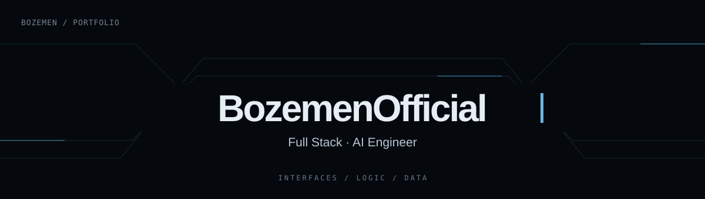

  

  

 

## ✨ Мои проекты

### 🖥️ [Portfolio — персональный сайт](https://github.com/BozemenOfficial/portfolio)

Сайт для знакомства со мной, моими навыками и работами.

[Открыть репозиторий →](https://github.com/BozemenOfficial/portfolio)

<h2 align="center">🧰 Мой стек</h2>

  

## 🌱 Сейчас в фокусе

Работаю над Traflume: постепенно развиваю проект, уделяю внимание интерфейсу, деталям и удобству использования.

Параллельно изучаю Docker — разбираюсь, как устроена серверная часть, как запускать приложения в контейнерах и организовывать рабочее окружение. Стараюсь сразу применять новое на практике и лучше понимать весь путь приложения: от кода до запуска.

## 💬 Связаться

[Telegram — @Life_Boze](https://t.me/Life_Boze) · [Мои публичные репозитории](https://github.com/BozemenOfficial?tab=repositories)
