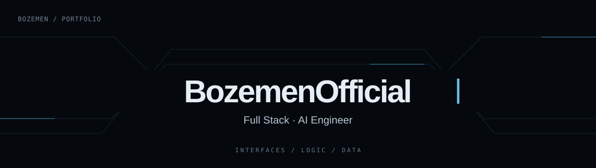

  

  

 

## ✨ Мої проєкти

### 🖥️ [Portfolio — персональний сайт](https://github.com/BozemenOfficial/portfolio)

Сайт для знайомства зі мною, моїми навичками та роботами. У репозиторії є версії інтерфейсу українською, російською й англійською, адаптивна верстка та анімації.

**Що демонструє:** React, TypeScript, CSS, організацію контенту та багатомовний інтерфейс.

[Відкрити репозиторій →](https://github.com/BozemenOfficial/portfolio)

## 🌱 Зараз у фокусі

## 💬 Зв’язатися

[Telegram — @Life_Boze](https://t.me/Life_Boze) · [Мої публічні репозиторії](https://github.com/BozemenOfficial?tab=repositories)
